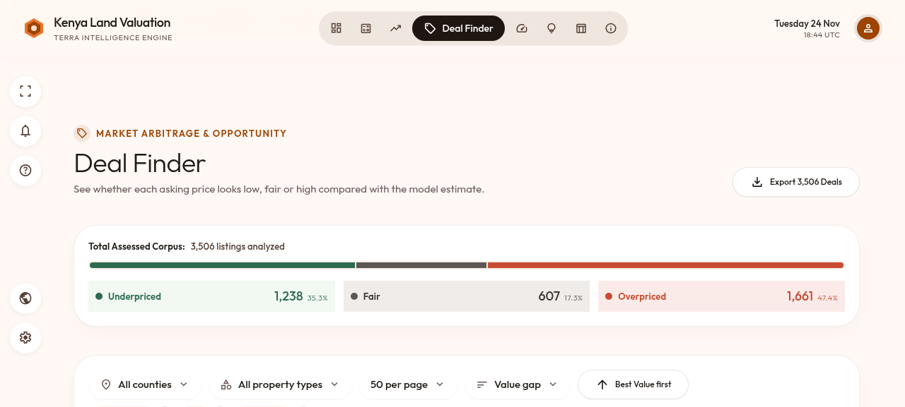

# Kenya Land Valuation

A full-stack land valuation platform for the Kenyan market: it estimates a
parcel's **price per acre** from scraped Property24 Kenya listings, shows an
**80% range** around every estimate, tags each listing **Underpriced / Fair /
Overpriced** against that range, and flags **Suspect data** rows whose asking
price is implausible relative to the model. Ensemble ML predictions, market
analytics, deal finding, and model explainability, in English and Kiswahili.

> **These are asking prices, not sale prices.** Every number in this app is
> derived from what sellers listed on public portals. Nothing here is an
> official valuation certificate. See [the model card](docs/model-card.md)
> and [data and legal notes](docs/data-and-legal.md).

> **Data sources.** Listings are scraped from **Property24 Kenya**
> (property24.co.ke) by a [separate scraper repo](https://github.com/uchih-a/scrapper);
> the committed `property24_kenya_finals.csv` (5,875 rows) carries Property24
> rows. **BuyRentKenya** is a secondary source the same scraper targets, but
> its rows are **not** in the committed CSV or the trained model in this
> snapshot. See [data and legal notes](docs/data-and-legal.md).



*The Deal Finder table: asking KSh/acre, the model estimate with its 80%
range, and the verdict chip for every cleaned listing (screenshot
[02](docs/assets/screenshots/02-suspect.png) shows the same view with
Suspect data chips revealed).*

<!--
VIDEO URL: TBC — 45-second demo to be recorded; poster image pending.
Block commented out so no broken image or link renders on the README.
[](TBC)
-->

## Reviewer path (about 5 minutes)

1. **[Architecture](docs/architecture.md)** (2 min) — how the raw scrape
   becomes a served prediction, and which layer owns which logic.
2. **[Model card](docs/model-card.md)** (2 min) — target, features,
   ensemble, metrics, the 80% range, limitations.
3. **[Evidence](docs/evidence.md)** (1 min) — test results, the parity
   check, sample predictions including a suspect-data case, degraded-mode
   behaviour.
4. Skim **[Decisions log](docs/decisions.md)** for the engineering
   judgement (parsing rules, three-feature choice, suspect thresholds,
   three incidents) and **[known gaps](docs/known-gaps.md)** for what was
   deliberately left unbuilt.

The full documentation index lives in [docs/README.md](docs/README.md).

## Quick start

The trained artifacts are **NOT in git** — they are large model and spatial
files. Run the three notebooks to produce them first, then copy them into
`artifacts/`.

```bash
git clone <this-repo> && cd kenya-land-valuation

# 1. Install backend deps (Python 3.12)
uv sync --extra dev
cp .env.example .env

# 2. Train: run the notebooks in order (Google Colab or locally)
#    notebook/01_data_preparation_and_feature_engineering.ipynb
#    notebook/02_exploratory_data_analysis.ipynb
#    notebook/03_modelling.ipynb
#    Notebook 1 reads the scraped CSV (property24_kenya_finals.csv, in this
#    repo) and the notebooks export artifacts/ at the end.

# 3. Copy the artifacts the notebooks produced into ./artifacts/
#    (models, app_exports, spatial GPKGs — see docs/artifacts.md)

# 4. Run
make dev          # backend  → http://localhost:8000/docs

cd frontend/
npm install       # or: bun install
npm run dev       # frontend → http://localhost:5173
```

Without the trained artifacts the app still boots in **degraded mode**:
`/health` returns `status: "degraded"`, and the endpoints that need the
model (`/predict`, `/places`, Model Performance, Explainability) return
`503 DATA_UNAVAILABLE`. See [RUN.md](RUN.md) for the full degraded
matrix and [troubleshooting](docs/troubleshooting.md) for common errors.

The frontend dev server proxies `/api` to `http://localhost:8000` (the
backend's default port), so both can run locally without CORS issues during
development. (If you open the frontend via `127.0.0.1:5173`, add that
origin to `ALLOWED_ORIGINS` — only the `localhost` variants are
pre-configured.)

## Repository layout

```
kenya-land-valuation/
├── backend/           FastAPI backend (Python, uv, Railway)
│   ├── app/           API routers, services, schemas, core
│   ├── tests/         pytest suite (379 passing; see docs/evidence.md)
│   └── ...
├── frontend/          Vite + React + TS frontend (Vercel)
│   ├── src/           App shell, design system, 8 screens, API client
│   └── ...
├── src/landval/       Shared Python library (features, modelling, cleaning)
├── notebook/          Notebooks 1–3 (train → artifacts)
├── docs/              Architecture, ADRs, API docs, known-gaps.md
├── artifacts/         Model + spatial data (git-ignored, mounted at runtime)
├── scripts/           Extraction + validation scripts
├── pyproject.toml     Backend project metadata + pinned deps
├── uv.lock            Backend lockfile (committed)
├── Dockerfile         Multi-stage container (uv-based)
├── Makefile           dev, test, lint, format, container, validate-version
├── .github/workflows/ ci.yml (backend) + ci-frontend.yml (frontend)
└── .gitignore         Covers both Python and Node artifacts
```

## Deployment

- **Backend**: Railway (Docker image via `Dockerfile`)
- **Frontend**: Vercel (Vite build via `frontend/`)
- CORS: backend's `ALLOWED_ORIGINS` must include the frontend's deployed
  origin. For local dev, both `http://localhost:3000` and
  `http://localhost:5173` are pre-configured in `.env.example`.

See [docs/deploy_railway_vercel.md](docs/deploy_railway_vercel.md) for
detailed deployment instructions.

## Artifacts

Model files and spatial data are **not committed** to git. Produce them by
running Notebooks 1–3, then place them in `artifacts/` (see
[docs/artifacts.md](docs/artifacts.md)). The backend enters "degraded"
mode without them — `/health` returns `status: degraded` and data
endpoints return 503 `DATA_UNAVAILABLE`, but the API still starts.

## User help (how to read the app)

- **Verdict chips** — each listing is tagged Underpriced, Fair, or
  Overpriced by comparing its asking price with the model's estimate range.
- **80% range** — the model's split-conformal interval: the price band that
  holds 80% of the time.
- **Suspect data** — a listing whose asking price is implausible relative
  to the model's location-aware estimate (listed far below or far above the
  model, or a non-finite size). These are excluded from deal verdicts and
  counted separately.
- **Data-quality flag** — a listing whose per-acre price falls outside the
  dataset's 1st–99th percentile window: a possible scraping or unit error,
  excluded from model training.

The suspect gate is not part of `/predict`; it runs on listings via
`GET /api/v1/listings/scored` (Deal Finder). Verdict chips on `/predict`
come from the comparable listings in the response.

The same copy ships in the in-app Help dialog (Kiswahili view:
[screenshot 03](docs/assets/screenshots/03-swahili-help.png)) and in the
[model card](docs/model-card.md). Languages: English and Kiswahili
(`en` / `sw`), switchable from the left rail or Settings.

## Known gaps

Start with the [Top open gaps](docs/known-gaps.md#top-open-gaps) summary
(the ten items most worth closing next, including the Kiswahili
native-review item), then the full consolidated list in
[docs/known-gaps.md](docs/known-gaps.md) — every reported gap,
approximation, and deliberate tradeoff across all build phases (B0–B12,
F0–F10).

## License

See [LICENSE](LICENSE).
