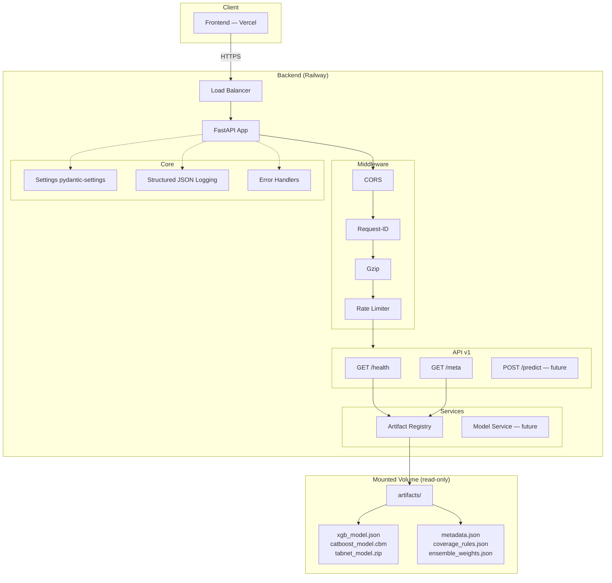

# Architecture

## Layers

## Request flow

1. Request hits Railway's load balancer → FastAPI app.
2. Middleware chain (CORS → Request-ID → Gzip → Rate limiter) processes the request.
3. Router dispatches to the appropriate handler.
4. Handler reads from the `ArtifactRegistry` (loaded once at startup via lifespan).
5. Response flows back through middleware (request-id header added, structured access log emitted).

## Degraded mode

When artifact files are missing the `ArtifactRegistry` sets `loaded = False`.
The app still starts (so `/docs`, tests, and CI work), but:
- `/health` returns `status: "degraded"`, `artifacts_loaded: false`
- `/meta` returns `null` for all data fields
- Prediction endpoints (future) return `503 ARTIFACT_NOT_LOADED`

## Logging

All logs are structured JSON (via structlog) in production, containing at minimum:
`timestamp`, `level`, `event`, `request_id`, `logger`. In development, logs are
pretty-printed to the console for readability.
