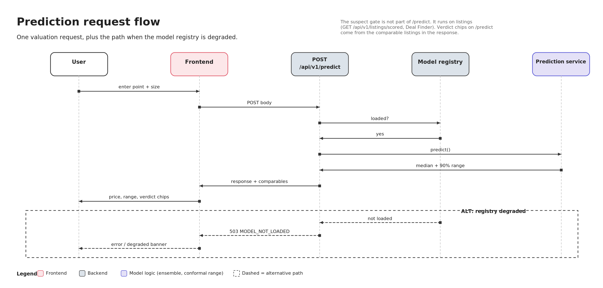

# Architecture

Two-line summary: how the raw Property24 scrape becomes a served
**price per acre** estimate — Notebook 1 (cleaning/features) →
Notebook 2 (EDA) → Notebook 3 (models/ensemble) → `artifacts/` → FastAPI
backend → React frontend, with each layer owning a distinct kind of logic.

For: reviewers who want to understand the system before reading code, and
maintainers changing one layer without breaking the others.

*Figure — system architecture: which layer owns which logic, from scraped listing to served valuation. Owner-provided, 2026-11-25.*

> Interactive board (Miro, view-only): **TBC — owner to provide the link.**

## Layers and what each owns

| Layer | Where | Owns |
|---|---|---|
| Scraper | external repo ([github.com/uchih-a/scrapper](https://github.com/uchih-a/scrapper)) | fetching raw listings; produces the CSV |
| Raw data | `property24_kenya_finals.csv` (committed, 5,875 rows) | nothing — inert input |
| Cleaning + features | `notebook/01_...ipynb` calling `src/landval/cleaning/*` | size parsing (`size_source`), price-basis detection (`price_basis`), geocoding, distances, infrastructure checklist |
| EDA | `notebook/02_...ipynb` | sanity checks and distributions; produces no artifacts |
| Modelling | `notebook/03_...ipynb` | feature selection, hyperparameters, ensemble weights, conformal calibration, all Phase 8/9 exports |
| Artifacts | `artifacts/` (git-ignored, produced by the notebooks) | the trained truth: models, weights, metrics, per-listing scores, spatial indexes |
| Backend | `backend/app/` (FastAPI) | loading artifacts once at startup, serving read-only aggregates, running live predictions, the suspect gate, canonical constants |
| Frontend | `frontend/src/` (React + Vite) | presentation, i18n, filtering/pagination state; no business logic |

The boundary rule: **any number the user sees is computed by the notebooks
or the backend, never typed in the frontend.** Thresholds live as named
constants in `backend/app/schemas/canonical.py` and are served through
`/meta` and the endpoint responses.

## Data flow, end to end

1. The scraper (separate repo) produces `property24_kenya_finals.csv`
   (5,875 rows, 12 columns — see the
   [data dictionary](data-dictionary.md)).
2. **Notebook 1** cleans and engineers: corrected size parsing
   (`src/landval/cleaning/size.py`), corrected price-basis detection
   (`src/landval/cleaning/price_basis.py`), geocoding, county assignment,
   distances (Nairobi, county town, water body), OSM amenity/accessibility
   scores, the 10-item infrastructure checklist. Output:
   `data/interim/kenya_land_engineered_final.parquet` (40 `FINAL_COLUMNS`).
3. **Notebook 2** explores; no artifacts.
4. **Notebook 3** trains OLS / XGBoost / CatBoost / TabNet baselines,
   selects features on the development set only, fits non-negative simplex
   ensemble weights on out-of-fold predictions, evaluates once on the test
   set, and exports everything the app needs (Phase 8 models + Phase 9
   app exports). See the [model card](model-card.md).
5. The backend loads `artifacts/` once at startup
   (`ArtifactRegistry` + `AppExportsRegistry`), then serves:
   - read-only aggregates (`/overview/summary`, `/counties/*`,
     `/model/*`, `/data/*`) vectorised in pandas over the exported frames;
   - live single-parcel predictions (`POST /predict`) through the loaded
     models with the conformal interval;
   - the per-listing Deal Finder table (`/listings/scored`), with the
     suspect gate applied at serve time (never persisted to the parquet).
6. The frontend renders. It holds no copies of thresholds, county lists,
   or model facts — everything arrives via the API.

## Degraded mode

When artifact files are missing, the registries set `loaded = False`. The
app still starts (so `/docs`, tests, and CI work), but:

- `/health` returns `status: "degraded"`, `artifacts_loaded: false`
- `/meta` returns `null` for the data fields
- endpoints needing the missing files return `503` with
  `error.code = "DATA_UNAVAILABLE"` and a `details` block naming the file
  and how to produce it
- the frontend shows a "Data may be incomplete" banner and per-card
  error+retry states; a failed query never blanks the page

Which endpoints work with only `artifacts/app_exports/listings_scored.parquet`
(the fixture-built file shipped in the run package) is tabulated in
[RUN.md](../RUN.md).

## Frontend (pages, verdicts, Suspect data chips, i18n)

Pages (React Router paths in `frontend/src/app/App.tsx`):

| Path | Screen | Primary data |
|---|---|---|
| `/` | Overview | `/overview/summary` |
| `/predictor` | Price Predictor (multi-step form) | `/predict/options`, `POST /predict` |
| `/market-insights` | Market Insights (choropleth + county ranking) | `/counties/summary`, `/counties/boundaries` |
| `/deal-finder` | Deal Finder (table + map) | `/listings/scored`, `/listings/options` |
| `/model-performance` | Model Performance | `/model/metrics`, `/model/predictions`, `/model/error-by-support` |
| `/explainability` | Explainability (SHAP) | `/model/explainability`, `/model/feature-evaluation` |
| `/data-explorer` | Data Explorer (5 tabs) | `/data/*`, `/counties/*`, `/listings/scored` |
| `/about`, `/settings`, `/more` | static / preferences | `/meta`, `/health` |

How verdicts are derived (backend; Notebook 3 Cell 9.6 export + serve-time
gate):

The suspect gate is not part of `/predict`; it runs on listings via
`GET /api/v1/listings/scored` (Deal Finder). Verdict chips on `/predict`
come from the comparable listings in the response.

- `verdict` comes from the exported interval columns: listed price below
  `low_price_per_acre_ksh` → `underpriced`; above
  `high_price_per_acre_ksh` → `overpriced`; else `fair`.
- `is_suspect` is computed at serve time by
  `backend/app/services/suspect_gate.py`: true when
  `listed_over_predicted` falls outside `[0.05, 20.0]` (canonical
  `SUSPECT_RATIO_LOW` / `SUSPECT_RATIO_HIGH`) or `size_acres` is
  non-finite/non-positive. Suspects are excluded from the verdict corpus
  counts and rendered with a grey **Suspect data** chip instead of a
  verdict colour.
- `data_quality_flag` is the notebook's 1st–99th percentile trim flag.

i18n: English and Kiswahili (`en`, `sw`) via i18next with all strings in
`frontend/src/lib/i18n/index.ts` (key parity enforced by a vitest test).
The language persists via safe storage; the left-rail globe toggles
`en ⇄ sw` using the same mechanism as the Settings page. Money goes
through one shared currency-aware formatter (KSh default; USD only when
the operator sets `FX_KSH_PER_USD` — no fallback rate).

## Request flow (serving)

1. Request hits the load balancer → FastAPI app.
2. Middleware chain (CORS → Request-ID → Gzip → rate limiter on
   `POST /predict`) processes the request.
3. The router reads from the registries (loaded once at startup via
   lifespan) or calls the prediction service.
4. The response flows back with the request-id header; structured access
   logs are emitted (JSON via structlog in production).

See [api.md](api.md) for the endpoint reference and the prediction flow.

*Figure — prediction request flow: one valuation request, plus the degraded-registry path. Owner-provided, 2026-11-25.*

## Logging

All logs are structured JSON (via structlog) in production, containing at
minimum: `timestamp`, `level`, `event`, `request_id`, `logger`. In
development, logs are pretty-printed to the console for readability.
