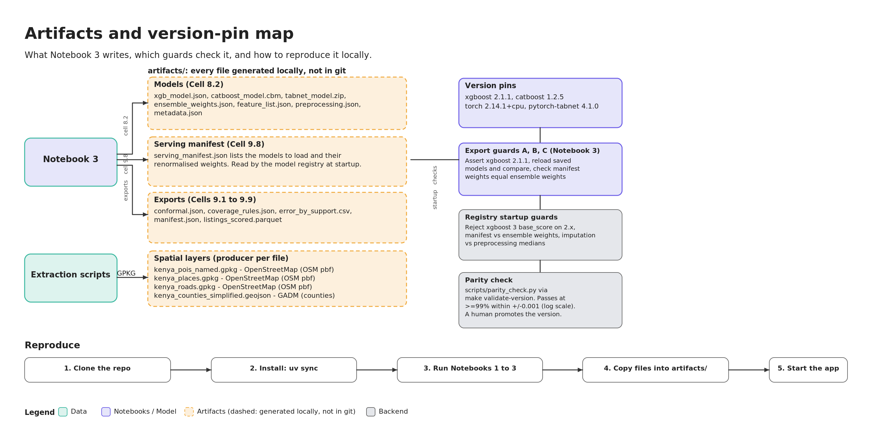

# Retrain and release runbook

Owner: [NAME]
Last verified: 2026-11-24

Two-line summary: the exact steps from "new scrape" to "serving a new
model" — run Notebooks 1–3, validate the exports, run the parity check,
promote with versioning. Never hot-swap artifacts while the service runs.

For: maintainers retraining after new data or a code change to the
cleaning/model library.



*Figure — artifacts and version-pin map: what is generated, what checks it, how to reproduce. Owner-provided, 2026-11-25.*

## Preconditions

- Python 3.12 with the pinned deps (`uv sync --extra dev`); training
  happens in the notebooks (Colab or locally) — the pins include
  **`xgboost==2.1.1`** (a 3.x runtime writes model files the server
  cannot read correctly; see
  [incident 2](decisions.md#incident-2--xgboost-3x-vs-211-lost-base_score)).
- `src/` importable from the notebooks
  (`sys.path.insert(0, "/path/to/src")` — the replacement cells include
  this).
- New scrape CSV (or the committed `property24_kenya_finals.csv`).

## 1. Apply the cleaning fixes to Notebook 1 (first retrain only)

Paste the labelled blocks from `notebook_patch/NB1_replacement_cells.py`
into the matching cells (45, 47, 49, 167, and the FINAL_COLUMNS additions
in Cell 169). The blocks call the corrected library code
(`src/landval/cleaning/size.py`, `price_basis.py`) instead of the legacy
in-cell regexes.

## 2. Run the notebooks in order

1. `notebook/01_data_preparation_and_feature_engineering.ipynb` —
   cleaning + features → `data/interim/kenya_land_engineered_final.parquet`.
2. `notebook/02_exploratory_data_analysis.ipynb` — EDA, no artifacts.
3. `notebook/03_modelling.ipynb` — phases 1–9: selection, tuning,
   ensemble, evaluation, export. All decisions are development-set only;
   the test set is read once per run.

## 3. Validate the exports before deploying

```bash
# a) the manifest-vs-disk check runs inside NB3 Cell 9.7 — read its output.
# b) replay the cleaning and compare to the expected funnel:
PYTHONPATH=backend:src python scripts/replay_cleaning.py
#    expected shape (committed CSV): usable ppa 3,958; size==0 = 0;
#    inf ppa = 0; 553 sizes changed; 153 conflicts.
# c) parity: backend recomputes predictions and compares to the stored ones
PYTHONPATH=backend:src python scripts/parity_check.py --artifacts-dir ./artifacts
#    requires the trained models; check FEATURE / MEMBER / ENSEMBLE
#    pass rates in the report.
# d) if parity fails on ensemble weights, compare the two weight files:
python scripts/diagnose_parity.py          # details on mismatches
python scripts/repair_serving_manifest.py --dry-run   # safe preview
```

**Worked example — the 2026-11-21 run failed step (c)** (report:
`parity_check_report.json`, 0% pass on test 640 and OOF 3,586 rows,
recomputed logs −4…−7 vs stored 17–21). Diagnosis: the training env was
xgboost 3.4.1 (`metadata.json`) so `xgb_model.json` again needs
`fix_xgb_base_score.py`, and the loaded manifest carried the stale
0.6211/0.2929/0.0860 weights instead of `ensemble_weights.json`'s
0.2295/0.6683/0.1022. Fix order:

```bash
python scripts/fix_xgb_base_score.py artifacts/xgb_model.json
python scripts/repair_serving_manifest.py --artifacts-dir ./artifacts
python scripts/parity_check.py --artifacts-dir ./artifacts   # must PASS
```

**Do not promote a run whose parity report has `overall_pass: false`.**

## 4. Promote the new run

ADR [0002 model versioning](decisions/0002-model-versioning.md) defines
the scheme; in short:

1. Copy the run's output into `ARTIFACTS_DIR/models/ensemble/<RUN_NAME>/`
   (or keep the flat layout for dev) — **model files, ensemble weights,
   and both manifests from the same run**, never mixed.
2. Set `ACTIVE_MODEL_VERSION=<RUN_NAME>` in the environment (empty =
   flat layout).
3. Restart the service. All registries load at startup; there is no
   hot reload by design.
4. Verify:
   ```bash
   curl -s localhost:8000/api/v1/health | jq .status        # "ok"
   curl -s localhost:8000/api/v1/meta | jq .model_version   # the run name
   ```

## 5. Rollback

Point `ACTIVE_MODEL_VERSION` at the previous versioned directory and
restart. Because runs are versioned (not overwritten), the previous model
is still on disk. If the layout is flat, restore from the backup taken
before the copy (`cp -r artifacts artifacts.bak-$(date +%F)`).

## Release checklist

- [ ] Notebooks ran without assertion failures (Cells 9.6's no-leakage
      asserts in particular).
- [ ] `replay_cleaning.py` aggregates match the expected funnel.
- [ ] `parity_check.py` ensemble pass rate acceptable (report recorded).
- [ ] `serving_manifest.json` weights == `ensemble_weights.json` weights.
- [ ] `xgb_model.json` written by 2.1.1 (or repaired via
      `fix_xgb_base_score.py`, `.bak` kept).
- [ ] `/health` = `ok` and `/meta.model_version` = the new run after
      restart.
- [ ] `docs/evidence.md` updated with the new metrics and date.
- [ ] OpenAPI snapshot unchanged (`python scripts/check_openapi_snapshot.py`).
